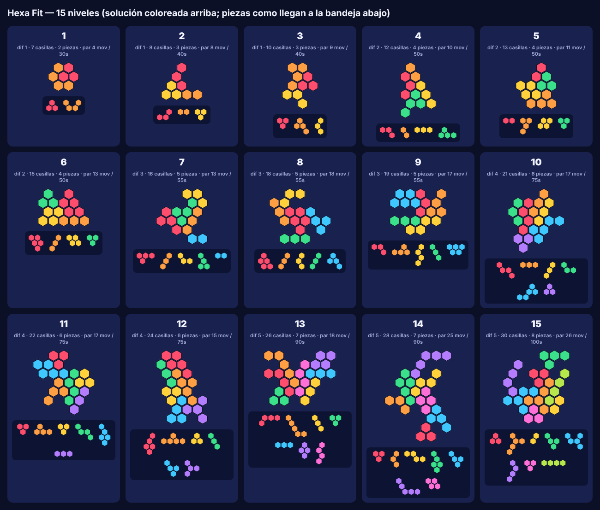

# Levels

The hand-designed levels of Hexa Fit (15, FR-46) and Hexa Sort (10, FR-55), one file per level in the format of [`docs/level-format.md`](../docs/level-format.md).
The app bundles these files (FR-04) and the API serves them (FR-23), so this folder is their single source.
Task document: [`odd/tasks/0003-hand-designed-levels.md`](../odd/tasks/0003-hand-designed-levels.md).

Difficulty grows from 1 to 5, three levels per step in Hexa Fit and two in Hexa Sort.

## Hexa Fit

| # | Difficulty | Cells | Pieces (cells each) | Solutions | Par moves | Par time |
|---|---|---|---|---|---|---|
| 1 | 1 | 7 | 2 (3, 4) | 6 | 4 | 30 s |
| 2 | 1 | 8 | 3 (3, 2, 3) | 2 | 8 | 40 s |
| 3 | 1 | 10 | 3 (3, 4, 3) | 2 | 9 | 40 s |
| 4 | 2 | 12 | 4 (3, 2, 3, 4) | 6 | 10 | 50 s |
| 5 | 2 | 13 | 4 (2, 4, 4, 3) | 4 | 11 | 50 s |
| 6 | 2 | 15 | 4 (5, 3, 4, 3) | 4 | 13 | 50 s |
| 7 | 3 | 16 | 5 (4, 3, 3, 4, 2) | 4 | 13 | 55 s |
| 8 | 3 | 18 | 5 (5, 3, 3, 3, 4) | 1 | 18 | 55 s |
| 9 | 3 | 19 | 5 (3, 4, 4, 3, 5) | 1 | 17 | 55 s |
| 10 | 4 | 21 | 6 (4, 3, 3, 3, 5, 3) | 1 | 17 | 75 s |
| 11 | 4 | 22 | 6 (3, 4, 3, 4, 5, 3) | 1 | 17 | 75 s |
| 12 | 4 | 24 | 6 (5, 5, 3, 3, 4, 4) | 1 | 15 | 75 s |
| 13 | 5 | 26 | 7 (4, 5, 3, 3, 3, 4, 4) | 1 | 18 | 90 s |
| 14 | 5 | 28 | 7 (3, 3, 4, 5, 4, 5, 4) | 1 | 25 | 90 s |
| 15 | 5 | 30 | 8 (3, 5, 2, 4, 5, 4, 3, 4) | 1 | 26 | 100 s |

How the difficulty grows: more cells and pieces, and fewer ways to solve the figure (counted by an exact-cover solver); from level 8 every figure has one solution.
Each piece reaches the tray turned 1 to 3 rotation steps away from its place in the reference solution, so the player has to rotate it.

- **Par moves** = pieces placed + the fewest rotation steps of the reference solution + half the pieces, rounded up, as room for mistakes (FIT-3, FIT-4).
- **Par time** = 14 s + 8 s per piece (+10 s at difficulty 4, +20 s at 5), rounded up to 5 s (FIT-3, FIT-5).

## Hexa Sort

| # | Difficulty | Goal (blocks of 10) | Colors | Stack size | Move thresholds (2★ / 3★) |
|---|---|---|---|---|---|
| 1 | 1 | 1 | 3 | 1–4 | 15 / 10 |
| 2 | 1 | 2 | 3 | 2–4 | 16 / 11 |
| 3 | 2 | 2 | 4 | 2–4 | 23 / 15 |
| 4 | 2 | 3 | 4 | 2–5 | 23 / 16 |
| 5 | 3 | 3 | 5 | 2–5 | 29 / 20 |
| 6 | 3 | 4 | 5 | 2–5 | 33 / 23 |
| 7 | 4 | 5 | 5 | 3–6 | 30 / 21 |
| 8 | 4 | 5 | 6 | 3–6 | 34 / 23 |
| 9 | 5 | 6 | 6 | 3–6 | 38 / 27 |
| 10 | 5 | 8 | 6 | 3–7 | 41 / 29 |

How the thresholds were set: a simulator that follows SORT-1 to SORT-5 played each level 400 times with a greedy player (it tries every empty cell and keeps the best result).
The 3★ threshold is the median number of moves of its winning games; the 2★ threshold is 1.3 times the 70th percentile, so most players earn 2 stars.
The greedy player wins 100% of levels 1–4 and about 80% of levels 9–10.

**Provisional:** the simulator draws stacks with its own generator (sizes uniform in the range, 1 to 3 runs of different colors). The engine's tray generator (SORT-6) is not written yet, so the thresholds must be checked again once it exists, with the same simulation over the real generator.

## Change a level

Edit its file and add 1 to `version`, so synced clients download it again (FR-14). Never change `levelId` or reuse a `number`.
